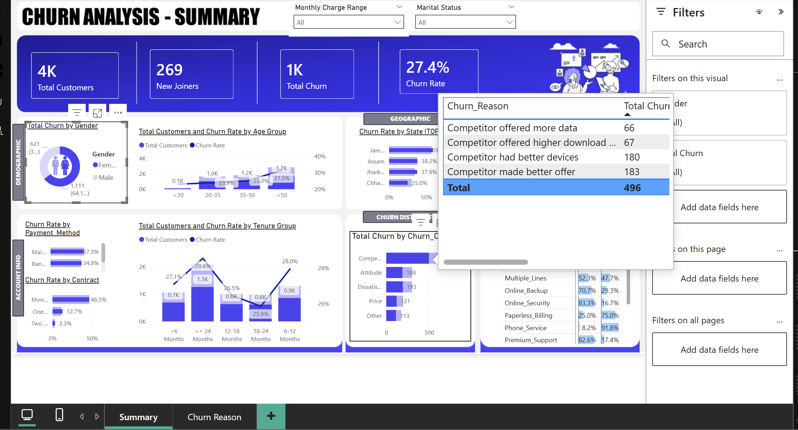

# CUSTOMER CHURN ANALYSIS DASHBOARD
## Business Question
Which customer segments, services, and account characteristics are most associated with churn, and which retention actions would likely have the greatest impact?

I built an interactive Power BI dashboard that identifies **who is leaving, where, and why**, so a telecom-style subscription business can focus its retention efforts.

## Data and Process
1. Source: Raw telecommunication kaggle dataset 
2. Extract and clean (SQL Server): audited each field for missing and inconsistent values, standardized categories, handled nulls, created derived fields such as tenure and age groups, and loaded the cleaned data for reporting.
3. Model and measure: Power BI
4. Visualize:designed a two-page dashboard organized by demographic, account, geographic, and service themes, with slicers for interactive filtering.

## Key Findings

Contract type is the strongest signal. Month-to-month customers churn at 46.5%, versus **11.0%** for one-year and **2.7%** for two-year contracts.
Fiber Optic customers churn at 41.1%, versus 25.7% for Cable, 19.4% for DSL, and 7.8% for customers with no internet service.
Geography varies widely.he highest-churn states reach 57.2% (top 5 shown on the dashboard), well above the 27.0% overall rate.
Age: churn rises with age, reaching **31.0%** in the over-50 group, which is also the largest age segment.
Payment method: customers paying by mailed check and bank withdrawal churn at 37.8% and 34.4%.
Why customers leave: Competitor-related reasons are the largest category (761 customers), ahead of Attitude (301), Dissatisfaction (300), Price (196), and Other (174).
Tenure shows a relatively flat churn rate (about 26% to 28% across groups), so tenure alone doesn't explain churn in this dataset.

## Recommendations

1. **Move month-to-month customers to longer contracts** through discounts or bundles, since this group churns at over four times the rate of one-year customers.
2. **Investigate the Fiber Optic experience.** It has the highest churn of any internet type, so check pricing, service quality, and support issues.
3. **Target high-churn states and the over-50 segment** with retention outreach.
4. **Counter competitor offers** with proactive retention messaging and offers for at-risk customers. 

## Tools

SQL Server (SSMS), Power BI, DAX, Excel

Churn analysis helps businesses:
1. Improve lifetime customer value (CLV)
2. Identify high-risk vs. loyal customers
3. Identify profitable vs. unprofitable churn
4. Identify behavioral patterns (usage drops, complaints, inactivity)
5. Attain useful customer segmentation

By studying churned customers, marketers can:
1. Exclude low-retention segments
2. Adjust channels that bring loyal vs. fleeting customers
3. This directly boosts ROI on advertisement revenue 
4. It enables proactive retention campaigns 

# PROJECT SCREENSHOT

